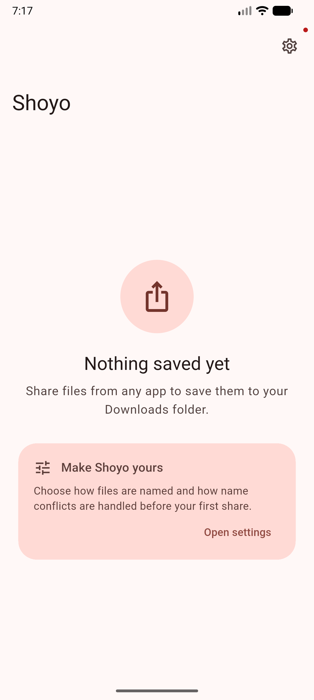
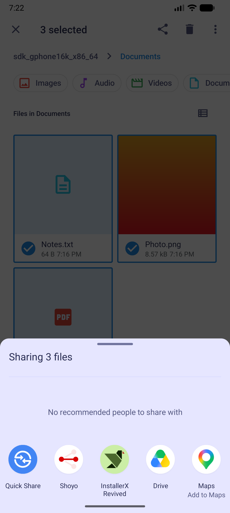
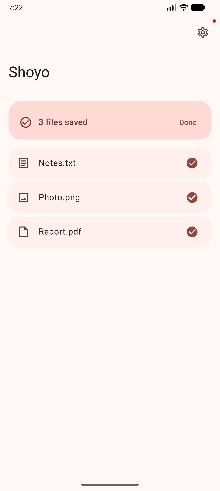
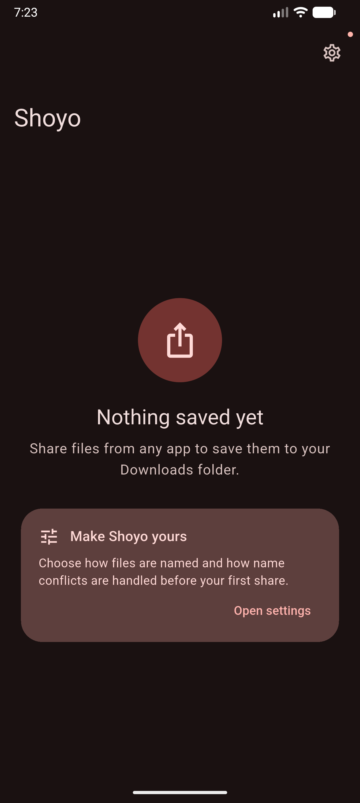

# Shoyo

Save files from the Android Share Sheet to local storage.

A more modern version of ["Send to SD card"](https://f-droid.org/packages/ru.gelin.android.sendtosd/).

Files are saved to the Downloads folder using MediaStore (Android 10+), so no
storage permissions are required.

## Features

- Save one or many shared files straight to Downloads.
- Optional filename editor: review and rename files before saving.
- Optional automatic renaming of name conflicts (`photo (1).jpg`), or manual
  renaming through the editor when disabled.
- Original red theme by default, with Material 3 Expressive and Material You
  (wallpaper-based) color options.
- Material 3 UI with large app bars, shaped cards, and expressive motion.

## Development

The Flutter SDK is installed locally into `./flutter` (gitignored) so every
checkout uses the same toolchain.

```sh
./scripts/install_flutter.sh   # clones Flutter stable into ./flutter
./flutter/bin/flutter pub get
./flutter/bin/flutter analyze
./flutter/bin/flutter test
./flutter/bin/flutter build apk --debug
```

`./build.sh` builds release APKs, signs the checksums with GPG, and copies the
results to `~/Downloads/Shoyo-build/`.

### Android

- `minSdk` 29 (Android 10), `targetSdk`/`compileSdk` from the Flutter template.
- Saving uses `MediaStore.Downloads` through the `dev.imranr.shoyo/media_store`
  platform channel in `MainActivity.kt` / `MediaStoreSaver.kt`.

## Screenshots

|  |            |
| ------------------------------------------------------ | ----------------------------------------------------------------------- |
|    |  |
